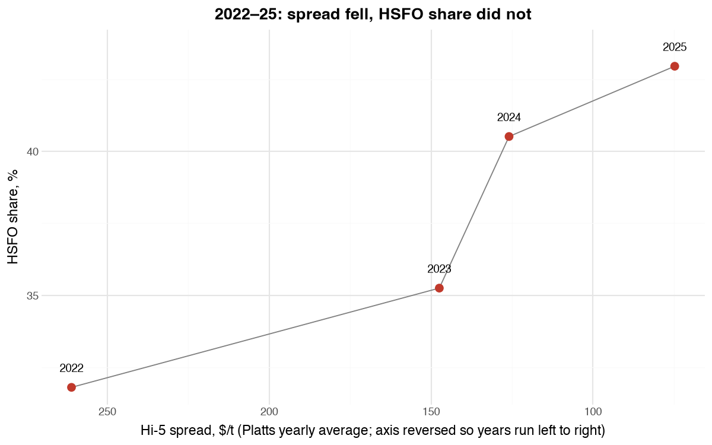
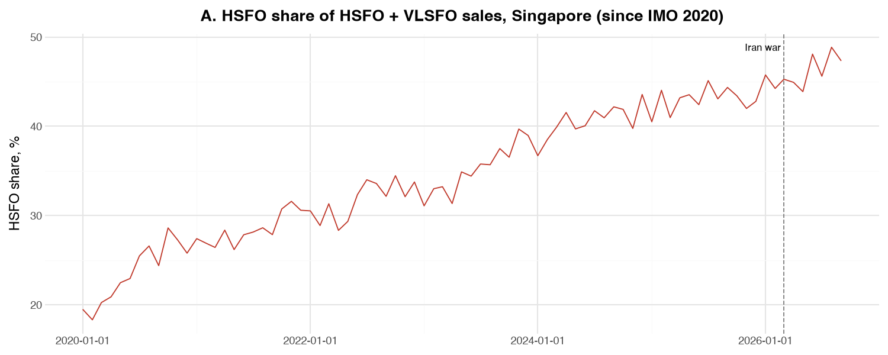
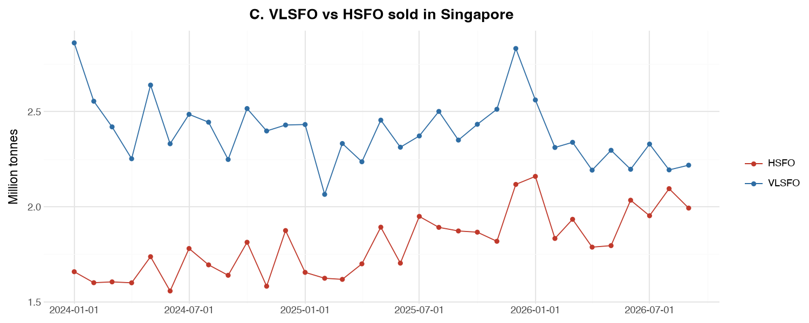

# Singapore Bunker Fuel: Is the Hi-5 Spread Driving HSFO Demand?

**[▶ View the interactive report](https://zyl-zug.github.io/sg-bunker-project/report/bunker_report.html)**. Hover over any point to see its value and source.

Singapore is the world's largest bunkering hub. Since IMO 2020, ships must burn low-sulphur fuel (VLSFO) or fit scrubbers that let them keep burning cheaper high-sulphur fuel oil (HSFO). This project asks whether HSFO's comeback in Singapore is driven by the price gap between the two fuels (the **Hi-5 spread**) or by structural demand from scrubber-fitted ships.

## Key findings
- **HSFO's share of Singapore fuel-oil sales rose from 24% (2020) to 46% (2026 year to date).**
- **The share kept rising while the Hi-5 spread narrowed from $261/t to $75/t (2022–2025).** This is consistent with structural scrubber demand rather than the spread alone.
- **In 2026, HSFO tonnes rose while VLSFO fell**, suggesting ships switched fuel rather than VLSFO buyers leaving Singapore for other ports.
- **What to watch:** whether the narrower spread seen in October 2026 pulls HSFO share back down in the next monthly releases.


*Chart 1. Each dot is one year. The spread fell every year from 2022 to 2025, while HSFO's share rose.*


*Chart 2. HSFO share of HSFO + VLSFO sales since 2020. The rise began before the March 2026 Middle East disruption.*


*Chart 3. Tonnes sold. HSFO rising while VLSFO falls points to ships switching fuel.*

## Data and sources

| Data | Source | How it's used |
|---|---|---|
| Monthly bunker sales by fuel type, Jan 1995 onward | [Maritime and Port Authority of Singapore, via data.gov.sg](https://data.gov.sg/datasets/d_4f5abbf4486bf8e52bbed3be56dde562/view) | Pulled automatically via the data.gov.sg API |
| Yearly average Hi-5 spread, 2022–2025 | [Platts, as reported by S&P Global (Dec 2025)](https://www.spglobal.com/energy/en/news-research/latest-news/refined-products/122325-commodities-2026-bunker-demand-to-buoy-asias-hsfo-market-ample-supply-likely-to-cap-major-upsides) | Chart 1; 2025 is year to date at publication |
| Selected monthly prices (Jul–Aug 2026) | [Ship & Bunker market analysis](https://shipandbunker.com/news/apac/537117-analysis-singapore-bunker-sales-continue-at-record-pace-despite-hormuz-crisis) | Context for 2026 |

**Definitions**
- **HSFO share** = HSFO ÷ (HSFO + VLSFO), in tonnes. MGO, biofuel blends and LNG are excluded, so the share compares only the two fuels a scrubber-fitted ship chooses between. It runs a few points higher than news figures that use total sales.
- **Hi-5 spread** = VLSFO price − HSFO price, in USD per tonne.
- MPA reports **"Marine Fuel Oil"** as HSFO. **"Low Sulphur Fuel Oil"** and **"Ultra Low Sulphur Fuel Oil"** are grouped as VLSFO.

## Method
1. **Collect:** download MPA monthly sales through the data.gov.sg API, with paging and retries (`get_bunker_data.py`).
2. **Clean:** group 16 MPA fuel labels into HSFO, VLSFO, distillates, biofuel, LNG and other alternative fuels; calculate HSFO share (`clean_reshape.py`).
3. **Compare:** set yearly HSFO share against Platts' yearly Hi-5 averages, and check tonnes for switching vs leakage to other ports.
4. **Present:** static charts (make_charts_gg.py) and a one-page interactive HTML report (make_report_html.py)..

## Limits
- **No free monthly HSFO price history.** Month-by-month price effects can't be tested; a trading desk would use Platts or Argus daily data.
- **Four yearly points** can show a pattern, not prove cause. Scrubber-fleet data was not available.
- **Singapore only.** Ships refuelling at other ports (e.g. Zhoushan) are not visible.
- **The latest month is a preliminary MPA estimate** and may be revised.

## Run it yourself
```bash
python3 -m venv .venv && source .venv/bin/activate
pip install -r requirements.txt
python get_bunker_data.py       # download MPA sales (no API key needed)
python clean_reshape.py         # group fuels, calculate HSFO share
python make_charts_gg.py        # static charts -> data/gg_*.png
python make_report_html.py      # one-page report -> report/bunker_report.html
```
An API key is optional. Copy `.env.example` to `.env` and add your data.gov.sg key for higher rate limits.

## Repository structure
```
├── get_bunker_data.py       # API download
├── clean_reshape.py         # fuel grouping + HSFO share
├── make_charts_gg.py        # static charts (plotnine)
├── make_report_html.py      # one-page HTML report
├── data/                    # raw and clean data, price files, charts
├── report/                  # bunker_report.html
└── requirements.txt
```

## Author
Zhenyan Lu, [LinkedIn](https://www.linkedin.com/in/zhenyanlu/)

Sales data: Maritime and Port Authority of Singapore, via data.gov.sg.
